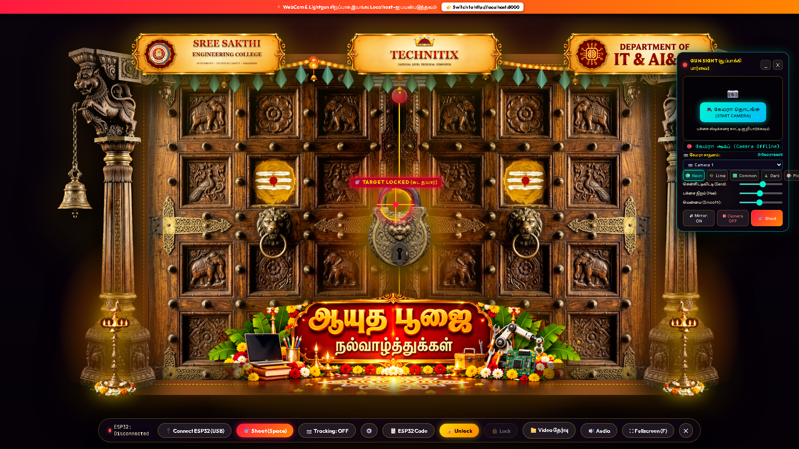
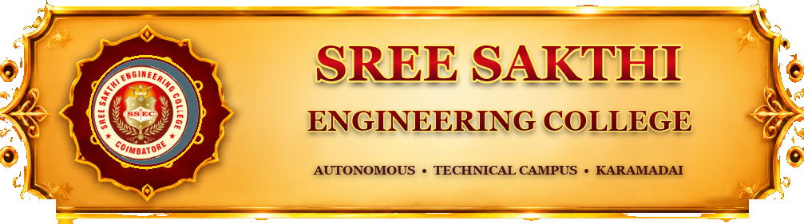

# 👑 TECHNITIX — Ayudha Pooja Interactive Experience

<div align="center">



### 🎯 An Interactive Festival Celebration Website Blending Cultural Heritage & Physical Computing
**Developed for the Ayudha Pooja Celebration**

[](#current-project-status)
[](https://nodejs.org/)
[](#hardware-setup)
[](#key-features)
[](#key-features)
[](#credits-and-license)

<br/>

**Institution:** Sree Sakthi Engineering College, Karamadai, Coimbatore, Tamil Nadu, India  
**Department:** Information Technology & Artificial Intelligence and Data Science (IT & AI&DS)  
**Lead Developer:** Rakesh  

---

[Project Overview](#project-overview) •
[Visual Showcase](#visual-showcase) •
[Key Features](#key-features) •
[How It Works](#how-it-works) •
[Technology Stack](#technology-stack) •
[Project Structure](#project-structure) •
[Local Setup](#installation-and-local-setup) •
[Media Configuration](#video-and-audio-configuration) •
[Controls](#controls-and-keyboard-shortcuts) •
[Hardware Setup](#hardware-setup) •
[Status & Limitations](#current-project-status) •
[Roadmap](#roadmap)

</div>

---

<a id="project-overview"></a>
## 📖 Project Overview

**TECHNITIX** is an interactive, festival-themed web celebration platform built for the **Ayudha Pooja** festival at **Sree Sakthi Engineering College (SREC)** by the **Department of Information Technology & Artificial Intelligence and Data Science (IT & AI&DS)**.

Ayudha Pooja is a traditional Indian celebration revering tools, machinery, craft, and technology as expressions of learning and creative empowerment. TECHNITIX modernizes this festival spirit by integrating **traditional Dravidian temple architectural motifs** with **modern web technologies, computer-vision aiming, and physical computing**:

- **Traditional Palace Gateway**: A festive royal entrance adorned with hand-carved Chettinad teakwood pillars, sacred Mavilai (mango leaf) thoranam with swaying marigold garlands, and flickering brass Kuthuvilakku oil lamps.
- **Locked Royal Doors & Aiming Reticle**: Massive carved wooden palace doors secured by a central antique temple brass padlock with an interactive targeting reticle.
- **Multi-Modal Shooting Controls**: Users can aim and fire at the padlock using a mouse, keyboard shortcut, on-screen button, or a custom DIY physical cardboard gun.
- **3D Lock Shattering & Door Opening**: Direct hits trigger a realistic 16-fragment 3D polygon lock shattering sequence, accompanied by procedural sound effects, kinetic spark bursts, falling marigold petals, and heavy doors swinging open in 3D perspective.
- **Celebration Presentation Video**: Opening the gates automatically launches the configured department video with audio streaming smoothly behind the entrance.
- **Optional Physical Computing & Vision**: Includes an optional real-time webcam color-tracking module for tracking a green gun sight marker and an optional WebSerial interface for connecting physical ESP32/Arduino trigger switches over USB.

> **Note**: The application is currently running as a **local development project** and has not yet been deployed to a public cloud hosting platform.

---

<a id="visual-showcase"></a>
## 🖼️ Visual Showcase

<div align="center">

### Main Festive Entrance & Lock Interface
The primary simulator interface renders the Chettinad teakwood pillars, traditional brass lamps, institutional plaques, and the central antique padlock target.


<br/>

### Heritage Elements & Commemorative Plaques
High-definition plaques mounted above the gateway honor the institution, festival event, and academic department:

| Institutional Crest | Central Festival Plaque | Department Plaque | Antique Temple Lock |
| :---: | :---: | :---: | :---: |
|  |  |  |  |
| **Sree Sakthi Eng. College** | **TECHNITIX Emblem** | **Department of IT & AI&DS** | **Padlock Target** |

</div>

---

<a id="key-features"></a>
## ✨ Key Features

### 1. Interactive User Interface
- **Dravidian Temple Styling**: Teakwood pillars with Bodhigai lotus brackets, temple bells, and brass base mounts.
- **Sacred Mavilai Thoranam**: Traditional folded mango leaves and marigold rosettes with synchronized CSS sway animations.
- **Dynamic Oil Lamps**: Kuthuvilakku brass lamps with multi-layered glowing flame animations.
- **Full-Screen Stage**: Immersive full-screen perspective layout with dynamic ambient lighting.

### 2. Aiming and Shooting Controls
- **Interactive Targeting Reticle**: A custom crosshair follows cursor coordinates across the screen.
- **Target Lock Detection**: Proximity collision detection activates lock state when hovering over the brass padlock, triggering visual reticle effects and audio confirmation beeps.
- **Multiple Trigger Inputs**: Shoot using `Spacebar`, mouse click, on-screen button, or physical hardware trigger switch.
- **Cinematic Ballistics**: Procedural muzzle flash, glowing bullet trajectories with fading particle trails, and realistic ricochet sparks bouncing off palace arches when missing the lock.

### 3. Door Lock and Unlock Experience
- **Realistic Lock Shattering**: Hitting the lock shatters it into 16 individual 3D polygonal shards with calculated velocity, rotational tumble, and gravity physics.
- **Procedural Web Audio**: Built-in sound synthesis generates authentic audio in real-time without relying on external audio files:
  - Muzzle blast crack with sub-bass punch
  - High-frequency metallic ricochet ping
  - Heavy kinetic brass fracture explosion
  - Sacred temple bell resonance
  - Auspicious royal celebration fanfare
- **Celebration Particle Systems**: Burst of 200 kinetic sparks on unlock followed by gently falling multi-colored marigold flower petals.
- **3D Gate Opening**: Heavy wooden doors swing outward in 3D perspective to reveal the media screen.
- **Manual Door Controls**: Dedicated buttons on the control bar allow testing unlock and lock sequences manually.

### 4. Video and Audio Configuration
- **Modular Media Config**: Video and audio paths configured in a single dedicated file (`database/media-config.js`).
- **Flexible Media Sources**: Supports local video files (MP4, WebM, MOV), relative project paths, and direct YouTube URLs.
- **Session File Upload**: An on-screen file input allows selecting local media files directly during an active presentation session.
- **Dedicated Media Portal**: Includes a secondary preview player (`frontend/media.html`) for testing media independently.
- **Live Watcher API**: The backend server exposes `/api/media-config` and checks for file updates every 1.0 second, automatically updating active playback without requiring a manual page refresh.

### 5. Webcam Tracking *(Optional / Experimental)*
- **In-Browser Vision Pipeline**: Color-based tracking running natively on HTML5 Canvas without heavy external dependencies.
- **Excess Green Index (ExG) + HSV**: Isolates green marker stickers using the excess green calculation (`2G - R - B`) combined with HSV hue tolerances.
- **Automatic Shirt & Room Rejection**: Connected-component analysis ignores large green objects (clothing, curtains, room walls > 250px) to lock exclusively onto small handheld markers (8px–40px).
- **Hand Tremor Suppression**: A sub-pixel deadband (< 1.8px) prevents jitter while resting, transitioning to adaptive Exponential Moving Average (EMA) smoothing during movement.
- **Interactive Calibration HUD**: Includes sliders for hue, sensitivity, and smoothing, preset color buttons (Neon, Lime, Common, Dark Green), an interactive color picker, and a mirror toggle.

### 6. ESP32 / Arduino Integration *(Optional Hardware Feature)*
- **Direct WebSerial Communication**: Communicates directly with microcontrollers over USB at 115200 baud in supported Chromium browsers.
- **Simple Push-Button Wiring**: Connects a momentary switch between `GPIO 4` and `GND` utilizing the internal pull-up resistor.
- **Debounced Trigger Processing**: Dedicated microcontroller sketch emits `SHOOT` commands on trigger pull and listens for `DOOR_UNLOCKED` events.
- **Built-in Code Modal**: Firmware sketch accessible directly from the control bar with one-click clipboard copying.

### 7. Local Video Streaming Backend
- **Native Node.js Server**: Zero external npm dependencies; runs using Node.js built-in `http`, `fs`, and `path` modules.
- **HTTP 206 Partial Content Streaming**: Supports byte-range requests for seamless video seeking and scrubbing.
- **Windows Path Auto-Healing**: Resolves Windows-style backslashes, drive letters, and unescaped characters automatically.

---

<a id="how-it-works"></a>
## 🔄 How It Works

```
1. Start Local Server ──► 2. Open in Browser ──► 3. Aim at Central Padlock
   (Port 5500)               (Chrome / Edge)         (Mouse or Green Marker)
                                                               │
                                                               ▼
6. Video Playback     ◄── 5. Shatter & Open  ◄── 4. Trigger Shot
   (MP4 / YouTube)           (Physics & Audio)       (Spacebar / Click / ESP32)
```

1. **Launch Server**: The Node.js server starts on `http://127.0.0.1:5500/` and handles file delivery, API config requests, and video range streaming.
2. **Access Web Page**: Open `finialpro1.html` in Google Chrome or Microsoft Edge.
3. **Aim at Target**: Move the mouse reticle (or calibrate the optional webcam tracker) toward the central antique brass padlock.
4. **Acquire Lock & Shoot**: When hovered over the lock, the crosshair confirms target acquisition. Fire using `Spacebar`, mouse click, or the physical hardware trigger.
5. **Unlock Sequence**: The bullet strikes the lock, fracturing it into tumbling 3D polygonal shards accompanied by synthesized sound effects, spark bursts, and flower petals as the doors open.
6. **Enjoy Presentation**: The configured presentation video automatically begins playing behind the open palace gates.

---

<a id="technology-stack"></a>
## 🛠️ Technology Stack

| Technology | Role in Project | Verification Status |
|---|---|---|
| **HTML5** | Semantic document structure, embedded video/iframe players, and 2D Canvas rendering | Confirmed in `frontend/*.html` |
| **CSS3** | 3D perspective transforms, CSS variables, flexbox, keyframe animations, and filter effects | Confirmed in `finialpro1.html` |
| **JavaScript (ES6+)** | Simulation engine, ballistics trajectory math, color filtering, state management, and DOM handling | Confirmed in `frontend/*.html` |
| **Node.js** | Built-in HTTP server (`backend/server.js`) providing static file delivery, config API, and HTTP 206 video streaming | Confirmed in `backend/server.js` |
| **HTML5 Canvas** | High-performance particle physics (sparks, petals), bullet trails, and webcam image data processing | Confirmed in `finialpro1.html` |
| **Web Audio API** | Real-time procedural audio synthesis for gunshots, ricochets, shatter crunch, temple bells, and fanfares | Confirmed in `finialpro1.html` |
| **WebSerial API** | USB serial communication with ESP32/Arduino microcontrollers at 115200 baud | Confirmed in `finialpro1.html` |
| **C++ (Arduino)** | Debounced trigger firmware for optional physical cardboard gun | Confirmed in ESP32 modal code |

*No heavy external frontend frameworks or third-party computer vision libraries are used; the application is built entirely with native web standards and Node.js core modules.*

---

<a id="project-structure"></a>
## 📁 Project Structure

```text
Ayudha-Pooja-Interactive-Festival-Website/
├── backend/
│   └── server.js                      # Localhost HTTP server & HTTP 206 video streamer (Port 5500)
├── database/
│   ├── media/                         # Local storage directory for user video/audio files
│   └── media-config.js                # Primary configuration file for media sources
├── frontend/
│   ├── assets/                        # High-resolution visual assets and institutional plaques
│   │   ├── antique_temple_brass_lock.png   # Central antique brass padlock target
│   │   ├── plaque_college_perfect.png      # Sree Sakthi Engineering College plaque
│   │   ├── plaque_dept_it_aids_perfect.png # Department of IT & AI&DS plaque
│   │   ├── plaque_technitix_perfect.png    # TECHNITIX festival emblem plaque
│   │   ├── srec_crest.png                  # Official SREC institutional crest
│   │   ├── tamil_kuthuvilakku_lamp.png     # Traditional brass oil lamp graphic
│   │   ├── tamil_palace_door_left.jpg      # Carved wooden door (left wing)
│   │   ├── tamil_palace_door_right.jpg     # Carved wooden door (right wing)
│   │   └── tamil_palace_pillar.png         # Chettinad carved teakwood pillar graphic
│   ├── finialpro1.html                # Main interactive palace simulator & vision engine
│   ├── index.html                     # Frontend launcher with localhost redirection
│   ├── media.html                     # Standalone media player & preview portal
│   └── preview_final.png              # UI preview screenshot of the locked entrance
├── package.json                       # Project configuration & npm start command
└── README.md                          # Project documentation
```

---

<a id="installation-and-local-setup"></a>
## 🚀 Installation and Local Setup

### Prerequisites
- **Node.js**: Version 14 or higher installed ([Download Node.js](https://nodejs.org/)).
- **Web Browser**: **Google Chrome** or **Microsoft Edge** (Chromium-based browser required for WebSerial and WebCam features).
- *(Optional)* USB Webcam for camera-based tracking.
- *(Optional)* ESP32 or Arduino board for physical trigger hardware.

### 1. Clone the Repository
```bash
git clone https://github.com/MRakesh8/Ayudha-Pooja-Interactive-Festival-Website.git
cd Ayudha-Pooja-Interactive-Festival-Website
```

### 2. Dependencies
No external package installation is required! The project runs using native Node.js core libraries (`http`, `fs`, `path`).

### 3. Start the Local Server
Run the project using npm:
```bash
npm start
```
*or directly with Node.js:*
```bash
node backend/server.js
```

You will see the startup confirmation in your terminal:
```text
================================================================
🚀 TECHNITIX ROYAL PALACE SERVER RUNNING AT:
👉 http://127.0.0.1:5500/
================================================================
```

### 4. Open the Application
Open your browser and navigate to:
- 🏛️ **Main Simulator**: [http://127.0.0.1:5500/finialpro1.html](http://127.0.0.1:5500/finialpro1.html)
- 🎬 **Dedicated Media Player**: [http://127.0.0.1:5500/media.html](http://127.0.0.1:5500/media.html)
- 🏠 **Default Launcher**: [http://127.0.0.1:5500/](http://127.0.0.1:5500/)

### 5. Stopping the Server
To stop the local server at any time, press `Ctrl + C` in your terminal window.

---

<a id="video-and-audio-configuration"></a>
## 🎬 Video and Audio Configuration

You can customize the video that plays when the palace gates swing open by editing `database/media-config.js`.

### Configuration File: `database/media-config.js`

```javascript
var TECHNITIX_MEDIA = {
  // 🎥 1. VIDEO SOURCE:
  //    - Relative Project Path : "database/media/celebration.mp4"
  //    - Local Drive Path      : "D:/Videos/department_presentation.mp4"
  //    - YouTube Link          : "https://www.youtube.com/watch?v=EXAMPLE_ID"
  video: "database/media/celebration.mp4",

  // 🔊 2. AUDIO SOURCE (Optional):
  audio: ""
};

if (typeof window !== 'undefined') {
  window.TECHNITIX_MEDIA = TECHNITIX_MEDIA;
}
if (typeof module !== 'undefined' && module.exports) {
  module.exports = TECHNITIX_MEDIA;
}
```

### Supported Media Formats
- **Local Video**: `.mp4`, `.webm`, `.mov`
- **YouTube Embeds**: Full URLs (`https://www.youtube.com/watch?v=...`) or short links (`https://youtu.be/...`)
- **Audio Files**: `.mp3`, `.wav`, `.ogg`, `.m4a`

### Automatic Live Reloading
When running via `backend/server.js`, the server exposes `/api/media-config`. The client webpage polls this endpoint every 1.0 second. Saving changes to `database/media-config.js` will automatically update the active video in the simulator without requiring a manual browser refresh.

---

<a id="controls-and-keyboard-shortcuts"></a>
## 🎮 Controls and Keyboard Shortcuts

| Action | Control / Shortcut | Description |
|---|---|---|
| **Aim Crosshair** | Mouse Movement | Moves targeting reticle across the screen |
| **Acquire Target** | Hover over Padlock | Locks crosshair onto the lock with audio confirmation |
| **Fire Weapon** | `Spacebar` / Mouse Left Click | Fires at the current crosshair position |
| **Shoot Button** | Control Bar `🎯 Shoot (Space)` | Fires weapon via on-screen button |
| **Toggle Tracking** | Control Bar `📷 Tracking: OFF/ON` | Starts or stops webcam computer-vision tracking |
| **Calibration HUD** | Control Bar `⚙️` Button | Opens/closes color sensitivity and calibration panel |
| **Connect Hardware** | Control Bar `🔌 Connect ESP32 (USB)` | Prompts for WebSerial USB connection to microcontroller |
| **ESP32 Firmware** | Control Bar `📋 ESP32 Code` | Opens modal with ready-to-copy Arduino C++ sketch |
| **Manual Unlock** | Control Bar `🔓 Unlock` | Manually triggers the unlock animation and opens doors |
| **Manual Lock** | Control Bar `🔒 Lock` | Resets and closes the doors, restoring the padlock |
| **Toggle Fullscreen** | `F` Key / Fullscreen Button | Enters or exits borderless presentation mode |
| **Close Overlays** | `Escape` Key | Exits fullscreen and closes open modals or HUD panels |
| **Minimize Controls** | Control Bar `✕` Button | Collapses the controls bar for clean presentation |
| **Restore Controls** | Floating `⚙️` Icon | Restores the minimized controls bar |

---

<a id="hardware-setup"></a>
## 🔌 Hardware & IoT Setup (Optional)

> **Notice**: Physical hardware integration is entirely optional. The website is fully functional using only standard mouse and keyboard controls.

For interactive exhibition setups (such as college festival booths), a physical cardboard lightgun can be built using an **ESP32** or **Arduino** board.

### 1. Wiring Schematic

Connect any standard momentary push button or micro-switch inside your cardboard gun trigger:

```
    ┌──────────────────────────────────────────┐
    │          ESP32 / ARDUINO BOARD           │
    │                                          │
    │   [ GPIO 4 ] ────────┐                   │
    │                      │                   │
    │                    ┌─┴─┐                 │
    │                    │   │ Momentary Switch│
    │                    │ O │ (Push-to-Make)  │
    │                    └───┘                 │
    │                      │                   │
    │   [  GND   ] ────────┘                   │
    └──────────────────────────────────────────┘
```

*Uses internal pull-up resistor on GPIO 4 (`INPUT_PULLUP`). No external pull-up resistor is required.*

### 2. Firmware Sketch (Arduino IDE)

Flash this sketch to your board at **115200 baud**:

```cpp
// =========================================================================
// TECHNITIX ESP32 / ARDUINO CARDBOARD GUN TRIGGER (Baud Rate: 115200)
// Wiring: Connect Trigger Push-Button between GPIO 4 and GND
// =========================================================================

const int TRIGGER_PIN = 4;
int lastState = HIGH;
unsigned long lastDebounceTime = 0;
const unsigned long DEBOUNCE_DELAY = 40; // milliseconds

void setup() {
  Serial.begin(115200);
  pinMode(TRIGGER_PIN, INPUT_PULLUP);
}

void loop() {
  int currentState = digitalRead(TRIGGER_PIN);

  if (currentState != lastState) {
    lastDebounceTime = millis();
  }

  if ((millis() - lastDebounceTime) > DEBOUNCE_DELAY) {
    if (currentState == LOW && lastState == HIGH) {
      // Trigger pressed -> Emit SHOOT command over WebSerial
      Serial.println("SHOOT");
    }
  }

  lastState = currentState;

  // Listen for unlock confirmation from browser
  if (Serial.available()) {
    String incoming = Serial.readStringUntil('\n');
    incoming.trim();
    if (incoming == "DOOR_UNLOCKED") {
      // Optional: Add haptic vibration or LED flash here
    }
  }
}
```

### 3. Connecting via WebSerial
1. Connect the microcontroller to your computer via USB.
2. In Google Chrome or Microsoft Edge, click **🔌 Connect ESP32 (USB)** on the control bar.
3. Select your microcontroller's serial port from the browser prompt and click **Connect**.
4. The status badge will display `ESP32: Connected (115200)`. Pulling the physical trigger will now fire the in-game reticle.

---

<a id="current-project-status"></a>
## 📌 Current Project Status

**Current Status: Local Development & Internal Testing**

- The application is currently maintained and tested as a **local project**.
- It has **not** been deployed to a public cloud hosting platform (e.g., Vercel, Netlify, or AWS).
- Running the full experience requires starting the local server via `node backend/server.js` or `npm start`.
- WebSerial and WebCam features require granting browser permissions on `localhost`.

---

<a id="known-limitations-and-troubleshooting"></a>
## ⚠️ Known Limitations and Troubleshooting

1. **Browser Compatibility**:
   - The WebSerial API is currently supported only on Chromium-based browsers (**Google Chrome**, **Microsoft Edge**, **Opera**). It is not supported on Mozilla Firefox or Apple Safari.
2. **Camera Permissions**:
   - Webcam tracking requires user permission. If blocked, check the browser address bar icon to allow camera access for `http://127.0.0.1:5500`.
3. **Audio Autoplay Policies**:
   - Modern browsers restrict audio from playing automatically without an initial user gesture. Click anywhere on the page or press a key to enable audio context playback.
4. **Local File Protocol (`file:///`) Limitations**:
   - Opening `finialpro1.html` directly via `file:///` restricts certain WebCam and WebSerial features and disables the `/api/media-config` endpoint. Always run through the local Node.js server.
5. **Port Conflict (Port 5500)**:
   - If Port 5500 is already in use by another service (such as VS Code Live Server), change the `PORT` constant in `backend/server.js` or terminate the conflicting process.

---

<a id="roadmap"></a>
## 🗺️ Roadmap

Planned future enhancements for upcoming iterations:

- [ ] **Public Cloud Deployment**: Optimize assets and implement cloud video streaming for public accessibility without a local Node.js server.
- [ ] **Mobile & Touch Optimization**: Add on-screen virtual joystick and touch tap-to-shoot support for mobile visitors.
- [ ] **Adaptive Lighting Vision**: Enhance camera tracking algorithms with auto-exposure compensation for varying exhibition lighting conditions.
- [ ] **Festive Theme Selector**: Provide alternate palace door themes and celebratory festival presets.
- [ ] **Expanded Sound Library**: Additional traditional instrument sound presets and ambient background temple music.

---

<a id="credits-and-license"></a>
## 👨‍💻 Credits and License

### Institutional & Departmental Credits
- **Institution**: **Sree Sakthi Engineering College (SREC)**, Karamadai, Coimbatore, Tamil Nadu, India.
- **Department**: **Department of Information Technology & Artificial Intelligence and Data Science (IT & AI&DS)**.
- **Occasion**: **Ayudha Pooja Celebration**.
- **Lead Developer**: **Rakesh**.

### License
This project is licensed under the **[ISC License](package.json)**:

```text
ISC License

Copyright (c) 2026 TECHNITIX / Sree Sakthi Engineering College

Permission to use, copy, modify, and/or distribute this software for any
purpose with or without fee is hereby granted, provided that the above
copyright notice and this permission notice appear in all copies.
```

---

<div align="center">
  <sub>Engineered with dedication for the Sree Sakthi Engineering College Ayudha Pooja Celebration.</sub>
</div>